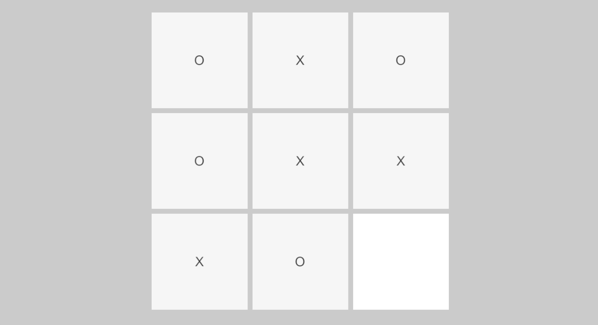
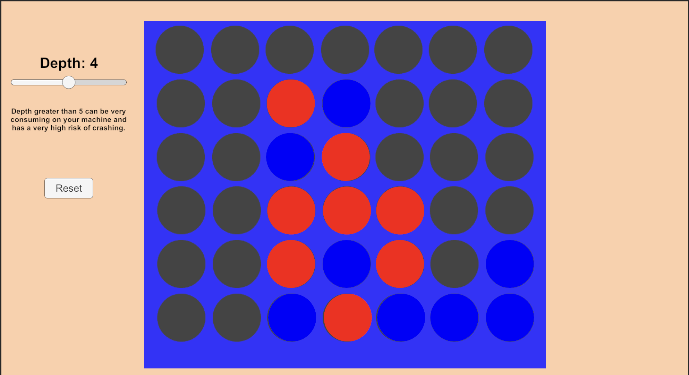

<div align="center">

# 🤖 Minimax Research

A research project exploring the minimax algorithm in Tic Tac Toe and Connect 4, and how search depth affects the decisions it makes.


</div>

---

## Preview

| Tic Tac Toe | Connect 4 |
|:---:|:---:|
|  |  |

## What I Did

I implemented the minimax algorithm from scratch and tested it on two boards of very different sizes:

- **Tic Tac Toe**, which is small enough for minimax to search every possible game
- **Connect 4**, which is far too large to search completely, so the algorithm has to stop at a limited depth

Each board is its own Unity scene with an adjustable search depth, so I could compare how the algorithm's decisions change as it looks further ahead.

## Why Minimax

- **It's the classic algorithm for two player games.** Tic Tac Toe and Connect 4 are both turn based, have no luck involved, and both players can see the whole board. That's exactly the kind of game minimax is designed for.
- **It shows a real tradeoff.** Searching deeper gives better decisions but costs much more time. Comparing a small board and a large one makes that tradeoff easy to see.
- **It's the base of more advanced game AI.** Techniques like alpha beta pruning and the search used in chess engines all build on minimax, so understanding it first makes those easier to learn.

## How Minimax Works

### The game tree

Every position in a game can lead to several next positions, one for each legal move. Drawing all of them out makes a tree:

```
                 current board
               /       |       \
           move A    move B    move C        ← AI's turn (maximize)
           /   \     /   \     /   \
          ..   ..   ..   ..   ..   ..        ← opponent's turn (minimize)
```

The root is the current board, each branch is a move, and the bottom of the tree is where the search stops.

### Maximizing and minimizing

The two players want opposite things:

- The **AI** is the **maximizer**. It wants the highest score.
- The **opponent** is the **minimizer**. It wants the lowest score.

On the AI's turn, minimax picks the move with the highest score. On the opponent's turn, it assumes the opponent picks the move with the lowest score. In other words, it assumes the opponent always plays perfectly.

### Scoring positions

When the search reaches the end of a branch, it gives that position a score:

| Position | Score |
|---|---|
| AI wins | high positive score |
| Opponent wins | high negative score |
| Draw | 0 |

Scores then pass back up the tree. Each level takes the maximum or the minimum of the level below, depending on whose turn it is. The move at the top with the best final score is the one the AI plays.

### A small example

Say the AI has two moves:

```
              AI picks max
             /            \
        move A            move B
      opponent: min     opponent: min
       /      \           /      \
     +10       0        +10     -10
```

- After **move A**, the opponent's best reply leads to **0**, so move A is worth **0**.
- After **move B**, the opponent's best reply leads to **-10**, so move B is worth **-10**.
- The AI picks **move A**.

Move B *could* lead to a win, but a perfect opponent would never allow it, so minimax plays the safer move.

### Depth

Depth is how many moves ahead the search goes before it stops.

- **Tic Tac Toe** has at most 9 moves, so the search can reach the end of every game. At full depth the algorithm plays perfectly and never loses.
- **Connect 4** has far too many possible games to search fully. The search stops at the chosen depth and uses a scoring function to estimate how good the board is, for example by counting how many pieces each player has lined up.

Every extra level of depth multiplies the number of positions to check. Connect 4 has up to 7 moves per turn, so each level can make the search about 7 times larger.

## How I Built It

1. **The board:** stored the board as a grid in C#, separate from what's shown on screen, so the algorithm could try moves without changing the real game
2. **Legal moves:** wrote a function that lists every move available in a position
3. **Win checking:** checked rows, columns and diagonals for a winner, and detected a full board as a draw
4. **Scoring:** gave wins, losses and draws their scores, and for Connect 4 added a scoring function for positions where the search stops before the game ends
5. **Minimax:** wrote the recursive search that tries each move, calls itself for the other player, then undoes the move and keeps the best score
6. **Depth control:** added a depth setting in each scene so the search can be limited and compared

## The Effect of Depth

| Board | What to observe |
|---|---|
| Tic Tac Toe | At full depth it plays perfectly and never loses. At low depth it makes clear mistakes. |
| Connect 4 | Higher depth catches threats earlier but takes noticeably longer to compute. |

## Tech

Unity 6 and C#. The minimax search, move generation and position scoring are all written from scratch with no external libraries.

## Project Structure

```
Minimax-Games/
├── Assets/
│   ├── Scenes/
│   ├── Scripts/
│   └── Screenshots/
├── Packages/
└── ProjectSettings/
```

## Running Locally

```bash
git clone https://github.com/Codoxide/Minimax-Games.git
```

Open the folder in **Unity 6** through Unity Hub. There's no main menu, so open either scene in `Assets/Scenes` directly, set the depth, and press **Play**.

---

<div align="center">

Built by Codoxide

</div>
